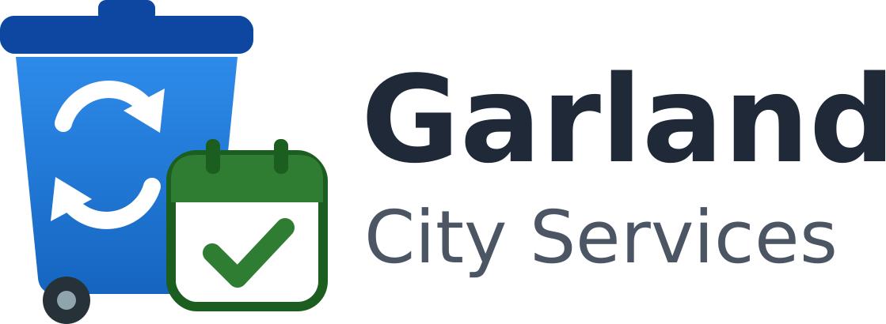

<p align="center">
  <picture>
    <source media="(prefers-color-scheme: dark)" srcset="images/dark_logo.png">
    
  </picture>
</p>

<p align="center">
  <a href="https://github.com/hacs/integration"></a>
  
  <a href="LICENSE"></a>
</p>

# Garland City Services for Home Assistant

**A trash, recycling and brush schedule for Garland, Texas that keeps itself up to date.**

Point it at your home and it works out your collection days from the City of Garland's own maps. It then keeps an eye on the city's website, so you don't have to:

- **Holiday changes are picked up automatically.** The integration reads the city's [Holiday Closure Information](https://www.garlandtx.gov/3694/Holiday-Closure-Information) page and moves your pickups when the city does, for example Thursday's pickup moving to Friday for Thanksgiving.
- **Schedule changes are detected.** If the city adds, moves or removes a holiday delay, Home Assistant fires an event you can use to send yourself a heads-up.
- **New recycling calendars are flagged.** When the city posts a new annual Blue/Yellow recycling calendar, a diagnostic sensor turns on and a Repairs notice appears with a link to the calendar.

The result is a schedule you can build automations on: Sonos reminders the night before, Telegram messages when a holiday moves your pickup, and a calendar on your dashboard.

> This is an independent community project. It is not made or endorsed by the City of Garland. It only reads the city's public web pages and map service.

---

## Contents

- [Install](#install)
- [Setup](#setup)
- [What you get](#what-you-get)
- [How it stays up to date](#how-it-stays-up-to-date)
- [Automation examples](#automation-examples)
  - [Sonos reminder the night before](#sonos-reminder-the-night-before)
  - [Telegram reminder](#telegram-reminder)
  - [Telegram alert when the city changes the holiday schedule](#telegram-alert-when-the-city-changes-the-holiday-schedule)
  - [Alert when a new recycling calendar is published](#alert-when-a-new-recycling-calendar-is-published)
  - [Alert when the city's website can't be read](#alert-when-the-citys-website-cant-be-read)
- [Events](#events)
- [Options](#options)
- [Data sources](#data-sources)
- [Limitations](#limitations)
- [Development](#development)

---

## Install

### HACS (recommended)

1. In HACS, open the **⋮** menu → **Custom repositories**.
2. Add `https://github.com/Jmanitpro/ha-garland-services` with type **Integration**.
3. Search for **Garland City Services**, install it, and restart Home Assistant.

### Manual

Copy `custom_components/garland_services` into `/config/custom_components/garland_services` and restart Home Assistant.

## Setup

**Settings → Devices & services → Add integration → Garland City Services.**

Your Home Assistant home location is filled in for you. It needs to be inside the City of Garland. There's no address lookup: the coordinates are matched against the city's trash, brush and recycling route maps.

## What you get

All entities belong to one device, **Garland waste collection**.

### Collection sensors

| Entity | What it shows |
|---|---|
| `sensor.garland_waste_collection_next_collection` | Date of the next collection day, whatever is being collected. The `message` attribute is ready to read aloud, e.g. *"Trash and Blue week recycling pickup is tomorrow, moved for Thanksgiving Day."* |
| `sensor.garland_waste_collection_next_trash_pickup` | Next trash date |
| `sensor.garland_waste_collection_next_recycling_pickup` | Next recycling date (every other week) |
| `sensor.garland_waste_collection_next_brush_and_bulky_pickup` | Next brush and bulky date |
| `sensor.garland_waste_collection_trash_pickup_in` (and recycling / brush) | Days until that pickup |
| `sensor.garland_waste_collection_recycling_week_group` | `Blue` or `Yellow` |
| `calendar.garland_waste_collection` | Every upcoming pickup, with holiday moves labeled |

Attributes on each "next pickup" sensor: `holiday_shift` (true/false), `regular_date`, `holiday` (name of the holiday, if moved). The recycling sensor also has `group` and `verified`.

`sensor.garland_waste_collection_next_collection` attributes: `services`, `days_until`, `holiday_shift`, `holiday`, `message`.

### Diagnostic entities

| Entity | What it tells you |
|---|---|
| `binary_sensor.garland_waste_collection_new_recycling_calendar` | **On** when the city has posted a recycling calendar for a year this integration hasn't verified yet. Attributes: `new_years`, `calendar_urls`. |
| `sensor.garland_waste_collection_recycling_calendar_year` | Newest recycling calendar year on the city's site, with `status`, `calendar_urls`, `published_years`, `verified_years`, `last_checked`. |
| `sensor.garland_waste_collection_holiday_schedule_source` | `live` (read from the city today), `cached` (city site unreachable, using last good read) or `built-in` (never read yet). Attributes list `upcoming_shifts`, every holiday on the page, `last_checked`, `last_changed`. |
| `sensor.garland_waste_collection_holiday_schedule_last_changed` | When the city last changed its holiday schedule. |
| `binary_sensor.garland_waste_collection_city_data_source_problem` | **On** if the map service or either city page couldn't be read on the last check. |

## How it stays up to date

Every 6 hours the integration:

1. **Looks up your routes** in the city's public map service. If the map service is down, it uses the last good lookup, so your schedule stays available.
2. **Reads the holiday page** and turns sentences like *"collections normally scheduled on Thursday will be collected on Friday, January 2, 2026"* or *"normally scheduled on Friday will move to Saturday"* into date moves. Holidays marked *"collection will not be affected"* are recorded but don't move anything. When this read differs from the previous one, it fires [`garland_services_schedule_changed`](#events). If the page can't be read, it keeps using the last good copy.
3. **Checks the recycling calendar page** for the newest annual Blue/Yellow calendar. A year newer than the last verified one turns on the *New recycling calendar* sensor, adds a Repairs notice, and fires [`garland_services_new_recycling_calendar`](#events) once.

At midnight the dates and countdowns roll forward without going back to the city's site.

**Recycling in a new year.** Recycling alternates Blue and Yellow weeks. Dates in a year the city's calendar has been checked against (currently 2026) are marked `verified: true`. For later years the integration keeps the every-other-week pattern going so your reminders don't stop, but marks those pickups `verified: false` and says so in the calendar entry. When the new calendar appears, the diagnostic sensor tells you to compare a few weeks against it. You can turn this off in [Options](#options).

## Automation examples

Replace `media_player.kitchen`, `tts.home_assistant_cloud`, and the Telegram chat ID with your own.

### Sonos reminder the night before

```yaml
alias: Garland - collection reminder on Sonos
triggers:
  - trigger: time
    at: "19:30:00"
conditions:
  - condition: template
    value_template: >
      {{ state_attr('sensor.garland_waste_collection_next_collection', 'days_until') == 1 }}
actions:
  - action: tts.speak
    target:
      entity_id: tts.home_assistant_cloud
    data:
      media_player_entity_id: media_player.kitchen
      message: >
        {{ state_attr('sensor.garland_waste_collection_next_collection', 'message') }}
        Please have the carts at the curb by 7 a.m.
mode: single
```

**Lower the music instead of stopping it.** Sonos supports announcements, which play over the music at a lower volume:

```yaml
  - action: media_player.play_media
    target:
      entity_id: media_player.kitchen
    data:
      announce: true
      media_content_type: music
      media_content_id: >
        media-source://tts/tts.home_assistant_cloud?message={{
          state_attr('sensor.garland_waste_collection_next_collection', 'message') | urlencode }}
```

### Telegram reminder

```yaml
alias: Garland - collection reminder on Telegram
triggers:
  - trigger: time
    at: "19:30:00"
conditions:
  - condition: template
    value_template: >
      {{ state_attr('sensor.garland_waste_collection_next_collection', 'days_until') == 1 }}
actions:
  - action: telegram_bot.send_message
    data:
      target: 123456789
      title: "🗑️ Collection tomorrow"
      message: "{{ state_attr('sensor.garland_waste_collection_next_collection', 'message') }}"
```

### Telegram alert when the city changes the holiday schedule

```yaml
alias: Garland - holiday schedule changed
triggers:
  - trigger: event
    event_type: garland_services_schedule_changed
actions:
  - action: telegram_bot.send_message
    data:
      target: 123456789
      title: "📅 Garland changed the pickup schedule"
      message: "{{ trigger.event.data.message }}"
```

### Alert when a new recycling calendar is published

Use the event (fires once per year) or the binary sensor (stays on until the year is verified):

```yaml
alias: Garland - new recycling calendar
triggers:
  - trigger: event
    event_type: garland_services_new_recycling_calendar
actions:
  - action: telegram_bot.send_message
    data:
      target: 123456789
      title: "♻️ New Garland recycling calendar"
      message: >
        {{ trigger.event.data.message }}
        {{ trigger.event.data.urls | first }}
  - action: persistent_notification.create
    data:
      title: "Garland {{ trigger.event.data.year }} recycling calendar"
      message: >
        Check the first few weeks against your Blue/Yellow group:
        {{ trigger.event.data.urls | first }}
```

### Alert when the city's website can't be read

```yaml
alias: Garland - city data source problem
triggers:
  - trigger: state
    entity_id: binary_sensor.garland_waste_collection_city_data_source_problem
    to: "on"
    for: "24:00:00"
actions:
  - action: telegram_bot.send_message
    data:
      target: 123456789
      message: >
        Garland Services couldn't read the city's site for a day and is using its last saved schedule.
        Holiday page: {{ state_attr('binary_sensor.garland_waste_collection_city_data_source_problem', 'holiday_page') }}
```

### Calendar trigger

Fire 12 hours before any pickup on the calendar:

```yaml
triggers:
  - trigger: calendar
    event: start
    entity_id: calendar.garland_waste_collection
    offset: "-12:00:00"
```

`trigger.calendar_event.summary` will be something like *"Trash pickup (moved for Christmas)"*.

## Events

| Event | When | `data` |
|---|---|---|
| `garland_services_schedule_changed` | The city adds, moves or removes a holiday delay | `message` (plain-English summary), `upcoming` (moves that haven't happened yet), `added`, `removed`, `entry_id` |
| `garland_services_new_recycling_calendar` | A recycling calendar for a new year appears (once per year) | `year`, `urls`, `message`, `entry_id` |

Each item in `added` / `removed` / `upcoming` looks like this:
`{"holiday": "Christmas", "regular_date": "2026-12-25", "new_date": "2026-12-26", "services": ["brush", "recycling", "trash"]}`.

## Options

**Settings → Devices & services → Garland City Services → Configure**

- **Project recycling into years without a verified calendar** (on by default). Turn it off to show no recycling dates for a year until a release has verified that year's calendar.

## Data sources

- [City of Garland ArcGIS MapServer](https://maps.garlandtx.gov/arcgis/rest/services/WebApps/MyGarland/MapServer): layers 6 (trash), 7 (brush), 8 (recycling)
- [Holiday Closure Information](https://www.garlandtx.gov/3694/Holiday-Closure-Information)
- [Reduce, Reuse, Recycle Calendar](https://www.garlandtx.gov/3814/Calendar) (annual Blue/Yellow calendar links)

All three are public and need no account or API key.

## Limitations

- The holiday reader understands the way the city words its notices today. If the wording changes so much that no holidays are recognized, the integration keeps the last good schedule and turns on the *City data source problem* sensor. It doesn't guess.
- Holiday notices that name a day without a full date (e.g. *"Thursday, December 31"*) are tied to the dated closure in the same paragraph.
- The integration reads the *list* of recycling calendars, not the PDF itself. Recycling dates in a new year are projected (see above) until that year is verified.
- Brush and bulky item rules (size limits, appointment items) aren't covered. This integration only tracks dates.
- The brand icon in the integrations list needs Home Assistant 2026.3 or newer. Everything else works on 2025.1 and later.

## Development

```bash
# Pure-logic tests (no Home Assistant needed)
python -m unittest tests.test_schedule -v

# Full Home Assistant tests
pip install pytest-homeassistant-custom-component
pytest
```

`tests/fixtures/` holds a saved copy of the city's holiday and calendar pages. When the city changes its page format, save a new copy there and add a test.

## Credits

The structure was inspired by [okie2020/ha-okc-services](https://github.com/okie2020/ha-okc-services) (Oklahoma City). This is an independent implementation, not a copy of that code. The logo is an original design and is not the City of Garland's seal or branding.

## License

[MIT](LICENSE)
